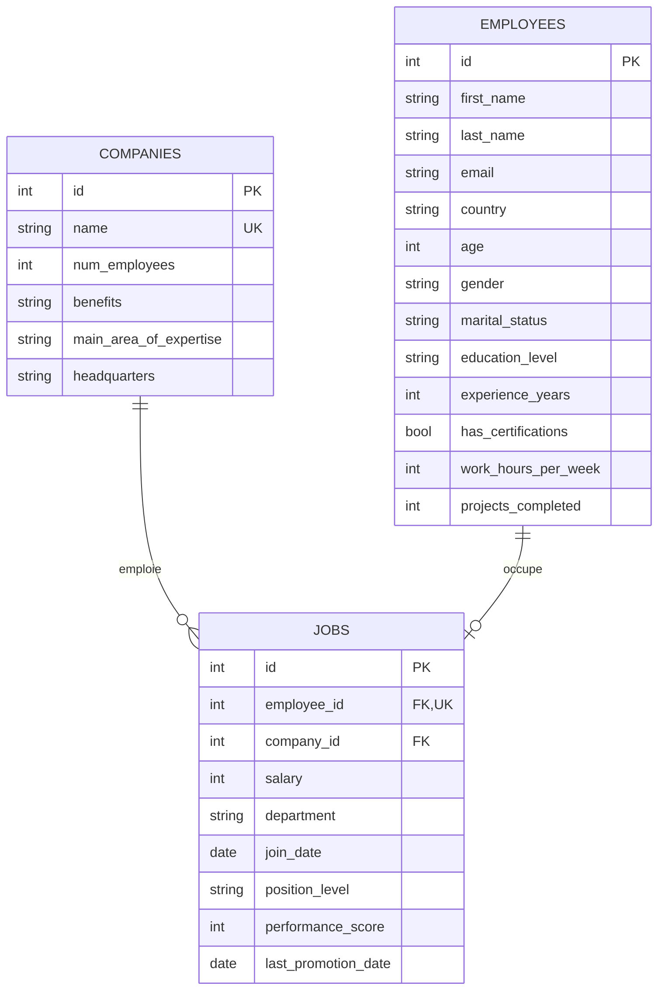

# Stonewindow : estimation des salaires GAFAM (ETL + ML)

Projet de correction de l'examen « Ingénierie des données - ETL & ML ».

## Fichiers

| Fichier | Rôle | Partie |
|---|---|---|
| `exploration.ipynb` | Exploration des données, choix de nettoyage | II.I Q.1 → Q.7 |
| `etl.py` | Script Extraction + Transformation (gestion d'erreurs) | II.I Q.8 |
| `docker-compose.yml`, `.env.example` | Base MySQL + phpMyAdmin | II.II Q.1 → Q.2 |
| `database.py` | Schéma de la base (ORM SQLAlchemy) + connexion | II.II Q.3 → Q.5 |
| `ingest.py` | Ingestion du JSON brut ligne par ligne via l'ORM | II.II Q.6 |
| `model.py` | Jointure SQL, encodage, entraînement, sauvegarde | III.I |
| `test_etl.py` | Tests : aplatissement, nettoyage, schéma, doublons | IV.I |

## Lancer le projet

```bash
python -m venv .venv
.venv/Scripts/pip install -r requirements.txt   # Linux/Mac : .venv/bin/pip
cp .env.example .env                            # puis modifier les mots de passe
docker compose up -d                            # MySQL + phpMyAdmin (http://localhost:8080)
python etl.py                                   # télécharge + transforme (aperçu)
python ingest.py                                # crée les tables + ingère
python model.py                                 # entraîne et sauvegarde models/salary_model.joblib
pytest -v                                       # tests (SQLite en mémoire, sans Docker)
```

## Workflow

```
S3 (JSON brut) ──download──> data/extract_async.json
      │
      ▼  pour chaque employé : flatten → clean_record → validate_record   (etl.py)
      │
      ▼  ORM SQLAlchemy, sans doublon                                     (ingest.py)
MySQL : companies / employees / jobs   ◄── phpMyAdmin (monitoring)
      │
      ▼  jointure SQL → One-Hot → RandomForest                            (model.py)
models/salary_model.joblib
```

## Partie II.I : ce que l'exploration a révélé

50 000 employés, chacun avec 4 blocs imbriqués : `personal`, `company`, `job`, `experience`.

| Problème | Correction |
|---|---|
| 2 063 personnes sans `company` / `job` / `experience` (emails gmail, âges 0-16) | Pas employées d'une GAFAM → hors analyse (gardées en base sans poste) |
| `last_promotion_date` manquant (2 330) | Jamais promu → `None` conservé |
| Chaînes vides (`marital_status`, `education_level`, `email`) | → `None` |
| Genre écrit de 6 façons (`M`, `Male`, `male`, ...) | → `M` / `F` |
| Âges et années d'expérience négatifs | Erreur de signe → valeur absolue |
| Salaire = 0 (2 405) | → `None` (inconnu) |
| Expérience > âge - 14 (2 332) | → `None` (impossible) |
| Dates en `YYYY-MM-DD` **et** `DD-MM-YYYY` (2 371) | Les deux formats sont lus |
| Doublons | Aucun dans le fichier (contrôle gardé à l'ingestion) |

## Partie II.II : base de données

- **Q.1** : MySQL 8.4 dans Docker, avec un utilisateur applicatif distinct de `root`.
- **Q.1.2** : les secrets sont dans `.env` (non versionné, voir `.gitignore`) et lus par `docker compose` et par Python (`python-dotenv`).
- **Q.1.3** : volume Docker nommé `mysql_data` monté sur `/var/lib/mysql` : les données survivent à l'arrêt ou à la suppression du conteneur.
- **Q.2** : phpMyAdmin sur http://localhost:8080.

### Schéma (Q.3)



Pourquoi ce découpage : les infos entreprise se répètent pour chaque employé (5 valeurs seulement), on les stocke une seule fois.
Le poste est séparé de l'employé car une personne peut ne pas avoir de poste (les 2 063 cas).

## Partie III : modèle

Résultat sur le jeu de test (20 %, 45 532 lignes au total) :

| Modèle | MAE | RMSE | R² |
|---|---|---|---|
| Baseline (moyenne) | 7 519 | 9 388 | 0.00 |
| RandomForest | 2 745 | 3 291 | 0.88 |

Variables les plus utiles : `performance_score`, `experience_years`, `position_level`.

### III.II Q.1 : pistes d'amélioration

- Valider les hyperparamètres par validation croisée (`GridSearchCV`) au lieu de valeurs fixées.
- Tester d'autres modèles (Gradient Boosting : XGBoost / LightGBM) et une régression linéaire pour l'interprétabilité.
- Mettre l'encodage dans un `Pipeline` scikit-learn (`OneHotEncoder(handle_unknown="ignore")`) pour qu'une nouvelle catégorie ne casse pas la prédiction.
- Mieux traiter les manquants (imputation par groupe plutôt que la médiane globale).
- Ajouter des variables : temps depuis la dernière promotion, pays regroupés par niveau de vie.
- Retirer les variables sensibles (genre) si on ne veut pas reproduire un biais salarial.

### III.II Q.2 : surveiller le modèle

- Enregistrer les métriques à chaque entraînement (MLflow) et comparer avec le modèle en production.
- Suivre la dérive des données (distribution des features en entrée, ex. Evidently) et de la cible quand de vrais salaires arrivent.
- Réentraîner automatiquement (ex. chaque mois, via Airflow / cron) après chaque nouvelle ingestion, et ne déployer que si le score est meilleur.
- Versionner modèle + données d'entraînement pour pouvoir revenir en arrière.

## Partie IV.I : tests

`pytest -v` lance 6 tests :
- l'aplatissement donne exactement le résultat de l'exemple du sujet ;
- le nettoyage corrige âge négatif, genre, chaîne vide, salaire nul, double format de date ;
- une ligne hors schéma (niveau `Boss`, id non entier...) est rejetée ;
- une ligne en double dans le fichier, ou relancer l'ingestion, n'ajoute aucun doublon.

Dans `ingest.py`, les lignes invalides sont loguées et ignorées, sans arrêter l'ingestion.

## Partie IV.II : impact écologique (estimation)

Mesures sur un PC portable : fichier de **64 Mo**, `etl.py` ≈ 2 s, `ingest.py` ≈ 35 s, `model.py` ≈ 3 s.

Hypothèse : collecte et réentraînement **1 fois par jour** (30 fois/mois).

| Poste | Calcul | Énergie / mois |
|---|---|---|
| Calcul des scripts | 40 s × 30 = 20 min à ~30 W | ≈ 0,01 kWh |
| Base MySQL allumée 24 h/24 | ~5 W × 720 h | ≈ 3,6 kWh |
| Téléchargement réseau | 64 Mo × 30 ≈ 1,9 Go × ~0,06 kWh/Go | ≈ 0,1 kWh |
| **Total** | | **≈ 3,7 kWh** |

Avec le mix électrique français (~50 gCO₂e/kWh) : **≈ 0,2 kg CO₂e par mois**, soit environ 1 km en voiture thermique.
Le poste principal est le serveur de base de données allumé en permanence, pas les scripts.

Sources :
- Intensité carbone de l'électricité en France : ADEME, Base Empreinte (https://base-empreinte.ademe.fr) et RTE éCO2mix (https://www.rte-france.com/eco2mix).
- Consommation des réseaux par Go : The Shift Project, « Lean ICT » (2019) ; les estimations varient beaucoup selon les études.
- Pour mesurer plutôt qu'estimer : la librairie `codecarbon` peut envelopper chaque script.
